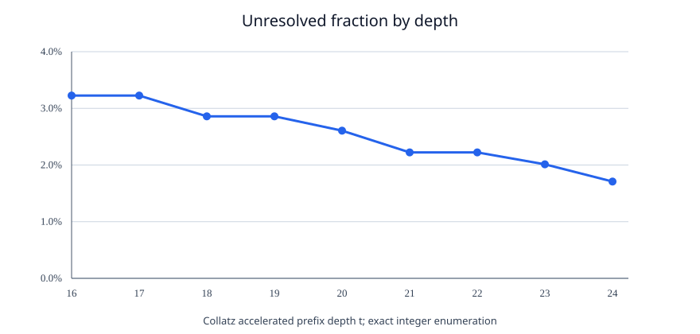
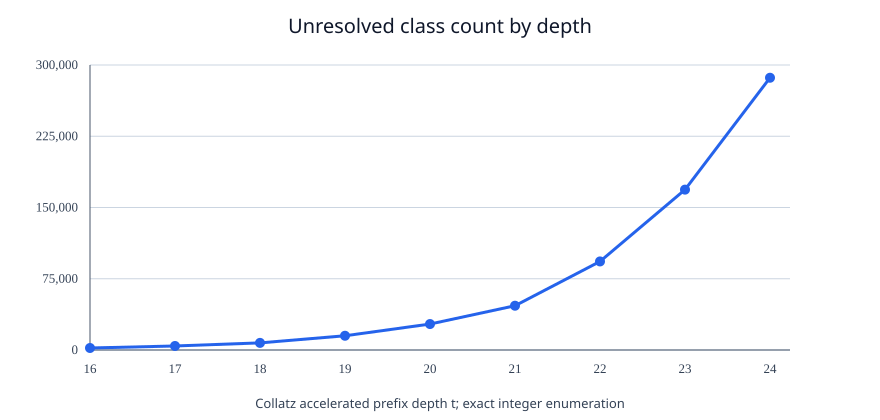

**Manuscript status:** Exploratory computational research and exposition; **not a proof or disproof of the Collatz conjecture**. Novelty claims have not been established by peer review. The mathematical facts taken from prior literature are attributed below; the new calculations here are finite, reproducible checks.

# Abstract

The accelerated Collatz iteration $T(n)=n/2$ for even positive integers and $T(n)=(3n+1)/2$ for odd ones is deterministic, yet its parity histories exhibit symbolic and statistical features that resemble random processes. Motivated by questions about emergent uncertainty, binary images, changes of positional base, complex amplitudes, and two-branch operator decompositions, we consolidate a sequence of exploratory investigations. The principal new calculation in this manuscript is a reproducible, exact-integer traversal of residue-class **first-drop certificates**. Beginning with 2,114 unresolved classes modulo $2^{16}$, we trace all unresolved descendants through depth 24, obtaining 286,581 unresolved classes modulo $2^{24}$, or 1.70816% of classes. The counts grow even while their fractions decline; some levels exhibit a doubling plateau. We prove the certificate criterion and explain why no fixed finite depth can eliminate all unresolved classes. Additional finite experiments investigate image rotations, alternative real and Gaussian-integer radices, and an illustrative complex-wavefunction center-selection procedure. They reveal representation-dependent patterns but no special rotation angle or physical quantum mechanism. All claims are explicitly separated into established results, finite verifications, and open problems.

**Keywords:** Collatz conjecture; $3n+1$; first-drop stopping time; 2-adic dynamics; parity vectors; residue trees; Sturmian words; symbolic dynamics; $\beta$-expansions; Gaussian radix; probability transfer; quantum walks.

# 1. Problem and research questions

For $n\in\mathbb N_{>0}$ define the accelerated Collatz map

$$
T(n)=\begin{cases}
E(n)=n/2,&n\equiv0\pmod 2,\\
O(n)=(3n+1)/2,&n\equiv1\pmod 2.
\end{cases}
$$

Its known positive cycle is $1\leftrightarrow2$; the unaccelerated map has the cycle $1\to4\to2\to1$. The **Collatz conjecture** asserts that all positive integers reach this cycle. No proof is claimed here. Earlier broad surveys and more recent progress include Lagarias [1], Terras's stopping-time results summarized in [1,2], Tao [3], and Barina's computational verification through $2^{71}$ [4].

This study asks: (i) whether apparent chance can arise from a deterministic parity history; (ii) how trajectories that have not **yet** descended below their starting value are organized by residue class; (iii) how representations in distinct numerical bases or on rotated lattices change visual correlations; (iv) what the additive constant contributes to ordered compositions of the two branch maps; and (v) whether complex numbers and wavefunctions add explanatory power or merely a new way to visualize deterministic information.

We distinguish a **nonconvergent orbit** (unknown to exist among positive integers) from an **unresolved finite prefix**, a class whose present finite certificate fails. Confusing the two would invalidate the research interpretation.

# 2. Mathematical foundations and prior work

## 2.1. Parity vectors and 2-adic dynamics

Write $b_j(n)=T^j(n)\bmod2$. The first $t$ parity bits form $Q_t(n)=(b_0,\ldots,b_{t-1})$. A classical parity-vector theorem gives a bijection between the $2^t$ residues modulo $2^t$ and the $2^t$ parity words of length $t$ [1,5]. On the 2-adic integers $\mathbb Z_2$, the full parity-vector map is a homeomorphism conjugating Collatz dynamics to the binary left shift [5]. This yields an exact deterministic source of Bernoulli-like symbolic dynamics. It does **not** mean that the next step of a fixed positive integer is random.

There is an important domain distinction: with Haar probability on $\mathbb Z_2$, the set of states that enter the cycle in a finite number of steps is countable and hence measure zero, whereas the positive integers form a countable subset of Haar measure zero. Thus a statement about almost every 2-adic state does not imply or refute universal convergence of positive integers.

## 2.2. A probability formulation with full support

An independent way to introduce probability is to randomly choose a positive integer with strictly positive mass at each value; for instance $\Pr(N=n)=2^{-n}$. If $\tau(n)$ is its first time to reach the positive cycle, then

$$
\Pr(\tau(N)>t)=\sum_{n\ge1}2^{-n}\mathbf1\{\tau(n)>t\}.
$$

Because every positive integer has positive mass, the limit of this survival probability equals zero **if and only if** Collatz holds. This is a correct reformulation, not a proof: nothing in the definition establishes the required zero limit. Similarly, density-one results do not rule out a sparse exceptional set. Tao's much stronger logarithmic-density theorem [3] is an established independent result, not an implication of the experiments here.

## 2.3. First drop and induction

Define the first-drop time for $n>1$ by $\sigma(n)=\min\{t\ge1:T^t(n)<n\}$, allowing infinity. By strong induction, Collatz is equivalent to $\sigma(n)<\infty$ for every positive $n>1$ [1,2]. Our numerical certificates target the first-drop property rather than the later arrival at 1.

# 3. Two branch maps and additive compensation

We treat $E(x)=x/2$ and $O(x)=(3x+1)/2$ as affine maps independently of their parity guards. Their order is significant:

$$
E\circ O(x)=\frac{3x+1}{4},\qquad O\circ E(x)=\frac{3x+2}{4},
\qquad(O\circ E-E\circ O)(x)=\frac14.
$$

This noncommutativity is **exact**. Along any parity word of length $t$, a composition has the affine form

$$
T^t(n)=\frac{3^{a_t}n+B_t}{2^t},\quad a_t=\sum_{j<t}b_j(n),\quad B_t\ge0.
\tag{1}
$$

For the accelerated odd rule, if an odd operation occurs at step $j$ (starting at $j=0$), its effect on the numerator is represented recursively by $B_{j+1}=3B_j+2^j$; for an even operation $B_{j+1}=B_j$. Eq. (1) exposes the additive-vs-multiplicative question in a precise form:

$$
T^t(n)<n\iff(2^t-3^{a_t})n>B_t.
\tag{2}
$$

If $3^{a_t}\ge2^t$, no positive $n$ following this parity prefix can drop at time $t$. If $3^{a_t}<2^t$, the additive term can still prevent a drop for sufficiently small members of the congruence class, but cannot do so for arbitrarily large members **of that fixed prefix**. Explicitly, $n>B_t/(2^t-3^{a_t})$ guarantees a drop at time $t$. The qualified phrase *fixed prefix* is indispensable: an infinite trajectory changes its parity history and $B_t$ with $t$. Rozier and Terracol [6] examine related “paradoxical” behavior beyond the first drop.

Example: $T^8(7)=8=(3^5\cdot7+347)/2^8$ even though $3^5/2^8<1$. Thus addition can offset multiplicative contraction, without implying it can do so forever.

# 4. Residue-class certificates: exact definitions and proof

Fix a depth $t\ge1$ and residue $0\le r<2^t$. Consider the class

$$C_{t,r}=\{n=r+j2^t:j\ge1\};$$

its smallest tested member is $n_0=r+2^t$. All members share their first $t$ parity bits [1,5], hence the same coefficients $(a_k,B_k)$ for $k\le t$.

**Proposition 1 (uniform class certificate).** If $T^k(n_0)<n_0$ for some $1\le k\le t$, then $T^k(n)<n$ for every $n\in C_{t,r}$.

*Proof.* From Eq. (2), a drop at $n_0$ requires $2^k-3^{a_k}>0$ and $(2^k-3^{a_k})n_0>B_k$. Every other $n\in C_{t,r}$ is at least $n_0$, so the same strict inequality holds. $\square$

We say $r$ is **certified at depth $t$** if Proposition 1 applies; otherwise $r$ is **unresolved at depth $t$**. Failure to certify says nothing about whether larger members eventually drop. We use Python arbitrary-precision integers, so the count does not rely on floating-point approximation.

**Proposition 2 (descendant pruning).** If a class is certified modulo $2^t$, then both of its descendants modulo $2^{t+1}$ are certified.

*Proof.* Each descendant consists of members of the parent class, all at least $2^{t+1}\ge2^t$. The parent certificate still applies, and its drop occurs within $t\le t+1$ steps. $\square$

Consequently we may enumerate all $2^{16}$ starting residues once, then test only descendants of unresolved parents at successive depths. This is an exact algorithm, not a sampling assumption. The supplied script also tests it against direct iteration on low depths.

# 5. New finite result: tracking the 2,114 classes to depth 24

The depth-16 enumeration reproduces the earlier number of 2,114 unresolved classes. Continuing the descendant-only traversal gives:

| Depth $t$ | Modulus $2^t$ | Unresolved classes $U_t$ | $U_t/2^t$ | Number of parents yielding two unresolved children |
|---:|---:|---:|---:|---:|
| 16 | 65,536 | 2,114 | 3.225708% | — |
| 17 | 131,072 | 4,228 | 3.225708% | 2,114 |
| 18 | 262,144 | 7,495 | 2.859116% | 3,267 |
| 19 | 524,288 | 14,990 | 2.859116% | 7,495 |
| 20 | 1,048,576 | 27,328 | 2.606201% | 12,338 |
| 21 | 2,097,152 | 46,611 | 2.222586% | 19,283 |
| 22 | 4,194,304 | 93,222 | 2.222586% | 46,611 |
| 23 | 8,388,608 | 168,807 | 2.012336% | 75,585 |
| 24 | 16,777,216 | 286,581 | 1.708156% | 117,774 |

At depths 17, 19, and 22, every unresolved parent produced both unresolved children; at depths 18, 20, 21, 23, and 24 some parents produced just one. Across this tested range no unresolved parent produced zero unresolved children. The alternating plateaus and contractions are deterministic consequences of parity-prefix inequalities, and resonate with the threshold sequence in Section 6. They do not establish a universal branching law.

**Crucial distinction.** The **absolute** unresolved count rises from 2,114 to 286,581 even as the **fraction** falls. The fractions are densities of residue classes with the specified uniform *finite-depth* certificate, not estimated probabilities of infinitely divergent integers. The counts also cannot be extrapolated indefinitely without a proof.

## 5.1. Why no fixed depth can settle every residue

**Proposition 3 (arbitrarily long initial resistance).** For every positive $k$, the integer $n=2^k-1$ experiences $k$ consecutive accelerated odd operations and has not dropped below its starting value within those $k$ steps.

*Proof.* By induction, $T^j(2^k-1)=3^j2^{k-j}-1$ for $0\le j\le k$. Each $j<k$ state is odd, and for $j>0$ this expression is strictly larger than $2^k-1$. Thus the first $k$ operations cannot establish a first drop. $\square$

This proves why a universal **fixed-depth** drop certificate is impossible: there are arbitrarily long but finite resistant prefixes. It does not give a nonconvergent positive integer. It also explains why compactness arguments in the 2-adic completion require special care: nested infinite parity histories need not represent a fixed ordinary positive integer.

# 6. An irrational threshold and symbolic dynamics

Ignoring the additive term for the moment, multiplicative contraction at step $t$ requires $3^{a_t}<2^t$. The boundary odd-count is described by $\alpha=\log_3(2)$, which is irrational (otherwise a nontrivial integer power of 3 would equal a power of 2). Its ceiling increments

$$
s_t=\lceil t\alpha\rceil-\lceil(t-1)\alpha\rceil\in\{0,1\}
\tag{3}
$$

form a mechanical/Sturmian word: a deterministic, aperiodic, low-complexity sequence [7]. Rational approximants such as $53/84$ can mimic finite stretches of the pattern. The familiar $22/7\approx\pi$ offers an analogy about accumulated approximation error, **not** an arithmetic link between $\pi$ and the Collatz conjecture. Equation (3) is only a multiplicative threshold; it does not by itself control $B_t$. The residue counts in Section 5 therefore need exact first-drop checks, not merely an odd-count threshold.

# 7. Inverse trees and hidden-state ambiguity

The inverse accelerated map has predecessors $2m$ for every positive $m$, and additionally $(2m-1)/3$ when $m\equiv2\pmod3$. Inverse-tree branching captures all finite paths that have arrived at the cycle at a fixed depth, but a fixed-depth inverse tree contains finitely many integers; its ordinary natural density tends to zero as the inspected range increases. This is **not** evidence against Collatz, which is an infinite-time statement.

A finite parity word identifies a residue class modulo $2^t$, not an exact positive integer. Earlier tests selected 4,096 integers sharing 12 parity observations, and found widely varying later stopping times. In the larger 2-adic setting, a rational 2-adic state with odd denominator can share arbitrarily long finite parity prefixes with an integer yet never become an integer, illustrating that finite observations cannot determine all long-term outcomes across the enlarged state space. This is a consequence of representation and information loss, not an example of an unknown divergent positive-integer trajectory.

# 8. Geometric rotations versus arithmetic representations

A 256-by-256 binary image may place $n=1+256y+x$ at coordinate $(x,y)$, with white meaning the orbit reaches 1 within 45 accelerated steps. Among $n=1,\ldots,65,536$, exactly 18,402 reach 1 within that window, and 47,134 do not yet reach it. These finite counts are checked in the provided code.

Rotating an image by an angle $\theta$ is a geometric transformation of pixel coordinates, not necessarily an algebraic symmetry of the Collatz map. Earlier 0.5-degree scans found weak whole-map correlations at nonstandard angles (roughly 0.02 for the strongest separated-from-zero peaks), with no special irrational-angle signature. Row-preserving shuffled controls sometimes produced stronger peaks, so searching across many centers/angles without controls is vulnerable to selection bias. This excludes a claim of discovered rotational invariance.

Binary bit-flips preserved more image-level correlation than typical Euclidean 90-degree rotations in preliminary tests. The reason is plausible: the x-coordinate encodes low binary bits, and parity histories are governed by residues modulo powers of 2. This conclusion is about the **chosen encoding**, not the existence of a preferred physical direction.

## 8.1. Integer, irrational, and complex bases

For any real $\beta>1$, greedy $\beta$-expansions can encode fractional coordinates. We studied digit-based rearrangements with $\beta=2,3,10,20,60,\sqrt2,\varphi,\pi$ and have added $e$ and normalized physical-constant examples to the explorer. The underlying integer transitions do not change with the chosen radix. Visual cluster statistics can change strongly because neighbors on the screen change.

We also include a genuinely complex representation: base $-1+i$ for Gaussian integers, whose digits are 0 and 1. For $z=a+bi$, set $d=(a+b)\bmod2\in\{0,1\}$ and take $(z-d)/(-1+i)$, iterating to obtain its digits. That is categorically different from using imaginary numbers as a literal ordering of the real numbers. This encoding is an exploratory visualization and supplies no new convergence constraint.

**Units warning:** the speed of light, Planck constant, gravitational constant, and Boltzmann constant have units. Using their raw numerical values as bases is meaningless without choosing reference units. Explorer labels explicitly disclose their *arbitrary dimensionless normalizations*; any apparent pattern may change if the normalizations change. Dimensionless $\alpha^{-1}$ and mathematical constants require no unit normalization.

# 9. Classical probability and complex state space

The classical distribution on states evolves by a transfer operator

$$
p_{t+1}(m)=\sum_{n:T(n)=m}p_t(n).
$$

A complex-amplitude description can assign $\psi(n)\in\mathbb C$ and preserve an additional path-history register: $|n,h\rangle\mapsto|T(n),h\mathbin\Vert b(n)\rangle$. With this register intact, initially distinct basis states remain distinguishable. Tracing out the register recovers the classical pushforward probabilities in a deliberately constructed finite model. This equality is expected by design; it does **not** indicate a physically quantum Collatz mechanism or a proof.

The explorer illustrates complex phases via multiplication by $e^{i\theta}$ and includes a *toy* center sampler using the Born probabilities of a superposition of two discrete free-Schrödinger plane-wave modes, $i\partial_t\psi=H\psi$, with $H=-\Delta/2$ on a periodic lattice (dimensionless units). The Hamiltonian is not derived from Collatz dynamics. Thus quantum physics is a source of modeling tools, not an experimentally established cause of the arithmetic patterns.

# 10. Numerical, visual, and linguistic caveats

Some initial investigations converted image pixels to bytes and searched for printable ASCII and other language-like patterns. This is not an encoding-invariant test: row/column order, bit order, byte alignment, and arbitrary language mappings can manufacture apparent messages. No coherent encoded language was verified. A rigorous direction is **symbolic dynamics**, which studies parity words as dynamics rather than as literal English text.

The apparent Sierpiński/Pascal-triangle resemblance also requires care. Pascal's triangle modulo 2 is genuinely related to binary arithmetic, but the Collatz survivor raster is not established to be the same fractal. Similarly, *Sturmian* is a mathematical name derived from Jacques Charles François Sturm; neither an ancient Tower of Babel derivation nor an Aztec solution to Collatz is documented. Historical numeral systems can nonetheless motivate useful changes of representation.

# 11. Research limitations and next falsifiable questions

The residue experiment supplies a verified, finite computation of a precise property; it does not prove an asymptotic law. Its output depends on the definition of *uniform certificate*, which should not be conflated with the stopping-time distribution over a bounded sample. Spatial correlations depend on the plotting convention, the interpolation method, the mask, and multiple testing. Differences among numeral bases are changes of representation only. Any quantum-inspired point selection must be compared against matched baselines and should eventually derive its operator from arithmetic if it is to be explanatory.

Future work can proceed on three concrete tests. First, derive an exact recursion for the *unresolved certificate frontier* and prove upper or lower bounds that incorporate $B_t$, rather than only $a_t$. Second, ask whether a bound can exclude an infinitely resistant **positive integer**, not just show that the fraction of resistant residue classes decays. Third, compare symbolic/2-adic encodings through a preregistered experiment with held-out data and null models preserving binary row structures. A formal proof would need to bridge the gap between natural density and universal quantification.

# 12. Reproducibility and attribution

Run `python src/track_residues.py --max-depth 24` and `python tests/test_residues.py` from the project directory. Both use Python 3 standard-library exact arithmetic for certificate verification; `matplotlib` is needed only for plotting. The standalone `explorer/index.html` runs in a browser without a server or network dependency. The repository includes aggregate CSV results, branching counts, code, and charts. No independent mathematical peer review is claimed.

**Research direction, questions, interactive-explorer feature requests:** GitHub user **Oblivion1276**. **AI-assisted formulation, implementation, analysis, drafting:** OpenAI **GPT-6**. **Prior scholarly results** are credited to their actual original authors below. The project should not be interpreted as assigning the user discovery credit for established parity-vector, stopping-time, Sturmian, or operator-theoretic theorems.

# References

1. Jeffrey C. Lagarias, “The 3x+1 Problem and its Generalizations,” *American Mathematical Monthly* **92** (1985), 3–23. https://doi.org/10.1080/00029890.1985.11971528
2. Eric W. Weisstein, “Collatz Stopping Time,” *MathWorld*, https://mathworld.wolfram.com/CollatzStoppingTime.html ; summarizing results by Riho Terras and others.
3. Terence Tao, “Almost all orbits of the Collatz map attain almost bounded values,” *Forum of Mathematics, Pi* **10** (2022), e12; https://arxiv.org/abs/1909.03562
4. David Barina, “Improved verification limit for the convergence of the Collatz conjecture,” *Journal of Supercomputing* **81** (2025), article 810. https://doi.org/10.1007/s11227-025-07337-0
5. Daniel J. Bernstein and Jeffrey C. Lagarias, “The 3x+1 Conjugacy Map,” *Canadian Journal of Mathematics* **48** (1996), 1154–1169. https://websites.umich.edu/~lagarias/doc/bernstein.pdf
6. Olivier Rozier and Claude Terracol, “Paradoxical behavior in Collatz sequences,” *Discrete Mathematics* **349** (2026), 115167; preprint https://arxiv.org/abs/2502.00948
7. M. Lothaire, *Algebraic Combinatorics on Words*, Chapter on Sturmian words, Cambridge University Press (2002); general introduction: https://en.wikipedia.org/wiki/Sturmian_word
8. Marc Chamberland, “An Update on the 3x+1 Problem,” survey, https://chamberland.math.grinnell.edu/papers/3x_survey_eng.pdf
9. NIST, *2022 CODATA Recommended Values of the Fundamental Physical Constants* (2024 release), https://physics.nist.gov/cuu/Constants/ ; used only for labels and dimensional cautions in the explorer.
10. Jeffrey C. Lagarias and Alan Weiss, “The 3x+1 Problem: Two Stochastic Models,” *Annals of Applied Probability* **2** (1992), 229–261. Bibliography and related papers at https://dept.math.lsa.umich.edu/~lagarias/3x%2B1.html

---

*This is a working paper, not a claim of a solved Millennium Prize problem (Collatz is not one of the seven official Millennium Prize Problems). All exact calculations are supplied so that errors can be found and corrected.*